# How these dotfiles work

Three views: where the repo sits in the stack, what the installer wires up,
and what happens at run time when you make a signed commit and push.

## 1. The stack



The repo only versions **configuration**. It never installs software:
package managers and the OS stay per-machine (the app lists in `packages/`
are git-ignored and kept local).

## 2. What `install.ps1` wires up



There are two kinds of link, and they behave differently when you edit the repo:

- **Live** — stubs and the git include *load files from the repo* every time a
  shell or git starts. Edit the repo file; the change applies in the next shell.
- **Copied** — SSH, GnuPG and WSL files are copied or generated into place, because
  ssh refuses config files other users can write (and everything under
  `C:\development` is writable by all signed-in users), and gpg-agent has no
  include directive. After editing `ssh/`, `gnupg/` or `windows/`, **re-run `install.ps1`**.

Every file the installer replaces is saved to `~/.dotfiles-backup/<timestamp>/` first.

### What loads when you open a terminal

| Shell | Load order |
|---|---|
| PowerShell 7 | `$PROFILE` stub → `powershell/profile.ps1` → repo `Modules/` on `PSModulePath`, PATH additions, PSReadLine, cached zoxide/gh init, gpg-agent check, Windows-only extras → `~/.profile.local.ps1` |
| bash (login) | `~/.bash_profile` stub → `bash/.bash_profile` → `~/.bashrc` stub → `bash/.bashrc` → `shell/aliases.sh`, `functions.sh`, `env.sh` → `~/.bashrc.local` |
| zsh | `~/.zshrc` stub → `zsh/.zshrc` → `shell/aliases.sh`, `functions.sh`, `env.sh` → `~/.zshrc.local` |
| vim | `~/.vimrc` stub → `vim/.vimrc` |
| git | `~/.gitconfig` → `include.path` → `git/gitconfig` + `git/gitconfig.windows` or `.unix` |

## 3. A signed commit and push, step by step



One GPG key does both jobs, using two subkeys that never leave gpg-agent:
the **[S]** subkey signs commits, and the **[A]** subkey answers GitHub's SSH
login challenge. The passphrase prompt only appears when the agent's cache
has expired (1 hour since last use, 24 hours max).

## Windows vs macOS / Linux

| | Windows | macOS / Linux |
|---|---|---|
| PowerShell profile stub | `Documents\PowerShell\Microsoft.PowerShell_profile.ps1` | `~/.config/powershell/Microsoft.PowerShell_profile.ps1` |
| Everyday shells | PowerShell 7, Git Bash | zsh (macOS default), bash |
| SSH client git uses | `C:\Windows\System32\OpenSSH\ssh.exe` (`core.sshCommand`) | system `ssh` |
| How ssh reaches gpg-agent | named pipe (`enable-win32-openssh-support`) | socket in `SSH_AUTH_SOCK` (`enable-ssh-support`) |
| Built-in ssh-agent | `ssh-agent` service must be **disabled** (it uses the same pipe) | not used |
| `gpg` git runs | `C:/Program Files/GnuPG/bin/gpg.exe` (not Git's bundled copy) | `gpg` |
| Passphrase prompt | Gpg4win pinentry window | `pinentry-mac`, or the terminal via `GPG_TTY` |
| GnuPG home | `%APPDATA%\gnupg` | `~/.gnupg` (installer makes it owner-only) |
| `dev` / `$DEV_HOME` | `C:\development` | `~/development` (WSL: `/mnt/c/development`) |
| Extras | `vsdev`, choco + winget completion, `Update-Path`, `.wslconfig` | — |

## Editing the diagrams

The sources are `docs/diagrams/*.html` (made with the
[diagram-design](https://github.com/cathrynlavery/diagram-design) skill).
After editing one, regenerate its SVG with the exporter in the skill's folder:

```sh
python <skill-folder>/scripts/export_svg.py docs/diagrams/install.html docs/diagrams/install.svg --system-fonts
```

`--system-fonts` keeps the SVG free of web-font requests; GitHub blocks
those in README images anyway.
